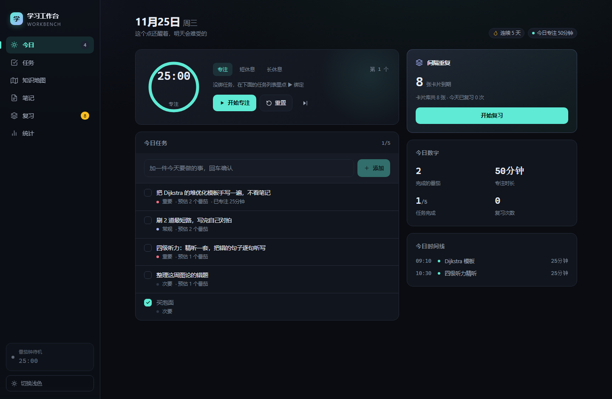
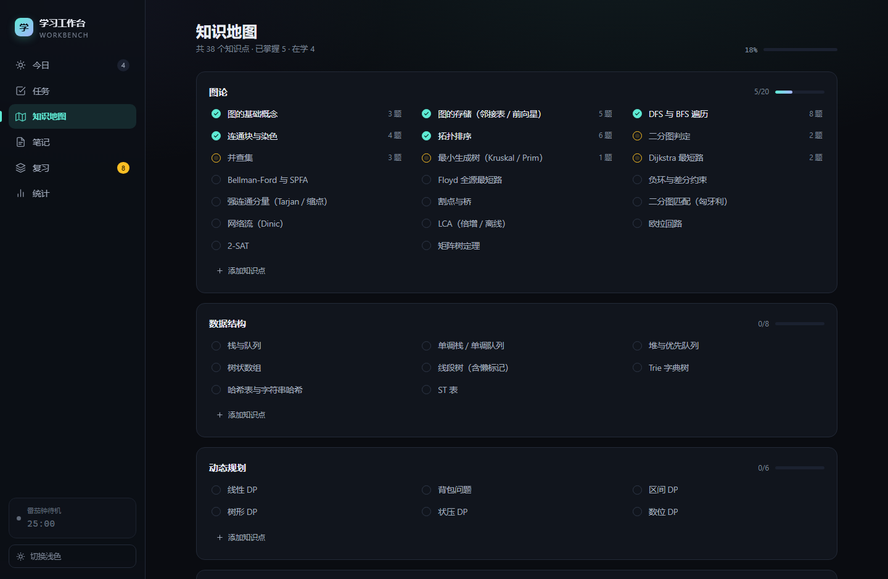

# 学习工作台 · Study Workbench

给自己做的一个小型学习系统。不追求功能多，只解决四件事：

**今天该干什么** → 番茄钟 + 任务清单
**学到哪了** → 算法知识地图
**该复习什么** → 间隔重复卡片
**最近有没有在动** → 学习热力图



## 功能

- **今日**：番茄钟（25 / 5 / 15，可绑定到具体任务）、今日任务、今日数字、专注时间线
- **任务**：按「过期 / 今天 / 明天 / 以后 / 收件箱 / 已完成」分组
- **知识地图**：预置一套图论、数据结构、DP、算法技巧大纲；点状态点循环切换「未开始 → 在学 → 已掌握」；支持备注和练题数
- **笔记**：Markdown 编辑与预览，编辑即自动保存，分「模板 / 踩坑 / 想法」
- **复习**：简化 SM-2 间隔重复，空格翻面、数字键 1-4 评分，带卡片库管理
- **统计**：全年热力图（一格一天）、最近 30 天专注柱状图、当前/最长连续天数




## 技术栈

| 层 | 用的东西 |
| --- | --- |
| 前端 | React 19 + TypeScript + Vite + SWR |
| 后端 | Fastify 5 + `node:sqlite`（Node 内置，零原生依赖） |
| 样式 | 手写 CSS，深色 / 浅色两套变量 |
| 数据 | 单文件 SQLite，备份就是拷 `data/workbench.db` |

选 `node:sqlite` 是为了省掉 `better-sqlite3` 的编译和平台差异：只要 Node ≥ 22.13 就能跑（会有一条 ExperimentalWarning，不影响），Docker 镜像也干净。

## 跑起来

需要 Node **22.13+**，推荐 24。Windows、WSL、macOS 都行。

```bash
pnpm install
pnpm dev
```

前端在 http://localhost:5173 ，接口在 8787（Vite 已经代理 `/api`）。

生产模式：

```bash
pnpm build
pnpm start
```

打开 http://127.0.0.1:8787 ，前端静态文件由同一个 Node 进程提供，不用另起服务。

第一次启动会自动建表，并写入一套图论知识点。

## 想先看看效果

```bash
pnpm seed          # 灌一批示例任务 / 笔记 / 卡片 / 专注记录
pnpm seed --force  # 清空后重灌
```

不想要了就删掉 `data/` 目录，重启即干净。

## 部署

**Docker（推荐）**

```bash
docker build -t study-workbench .
docker run -d -p 8787:8787 -v "$(pwd)/data:/app/data" --name wb study-workbench
```

**Render / Railway / Fly.io 这类平台**

- Build Command：`pnpm install && pnpm build`
- Start Command：`node ./node_modules/tsx/dist/cli.mjs src/server/index.ts`
- 环境变量：`HOST=0.0.0.0`、`PORT=8787`、`DATA_DIR=/data`
- 挂一个持久磁盘到 `/data`

免费实例的磁盘通常不持久，重启会丢数据。要么挂 volume，要么定期用「统计 → 导出全部数据」存一份 JSON。

## 接口

都在 `/api` 下，返回 JSON。常用的几个：

| 方法 | 路径 | 说明 |
| --- | --- | --- |
| GET | `/api/today?date=YYYY-MM-DD` | 首屏要的全量数据 |
| GET | `/api/stats/activity?from=&to=` | 逐日活跃度，热力图用 |
| GET / POST | `/api/export` · `/api/import` | 全量备份与恢复 |
| POST | `/api/cards/:id/review` | 提交一次复习评分 |

## 一些设计取舍

- **没有登录**。这是给一个人用的东西，跑在本机或自己的服务器上。要公开访问，自己在前面加一层反代 + 认证。
- **日期一律是本地 `YYYY-MM-DD` 字符串**，由前端传，服务端不做时区推断。这样跨时区、跨夏令时都不会错位。
- **番茄钟记录的是完整的一段**：暂停再继续不会拆成两条，结束时按总时长落一条记录。
- **间隔重复是简化的 SM-2**：忘了当天重来，勉强 ×1.2，记得 × 难度系数，简单 ×1.3 并且难度系数 +0.15。

## 目录

```
src/
  shared/        前后端共用：类型、日期工具、SM-2、预置大纲
  server/        Fastify 应用、路由、SQLite
  web/           React 页面与组件
data/            运行时生成的 SQLite（已 gitignore）
```

## License

MIT，随便改。
