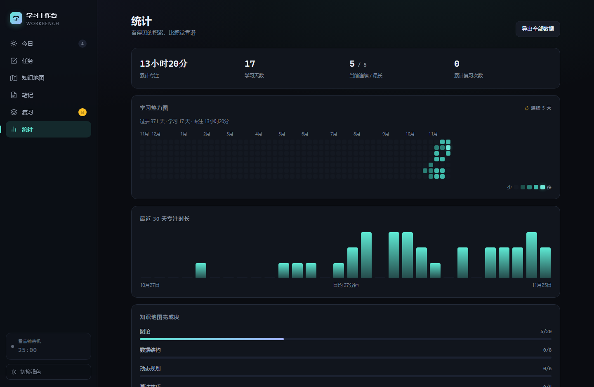

# Study Workbench

**English** | [简体中文](README.zh-CN.md)

[](https://github.com/aspringtime/study-workbench/actions/workflows/ci.yml)
[](https://github.com/aspringtime/study-workbench/releases)
[](LICENSE)

A small learning system I built for myself. It doesn't try to do everything — just four things:

**What should I do today?** → Pomodoro timer and a task list
**Where am I?** → a map of algorithms and concepts
**What needs reviewing?** → spaced-repetition cards
**Have I been showing up?** → a study heatmap


## Features

- **Today** — Pomodoro timer (25 / 5 / 15, bindable to a task), today's tasks, today's numbers, a timeline of focus sessions
- **Tasks** — grouped into overdue / today / tomorrow / later / inbox / done
- **Knowledge map** — a built-in outline of graph theory, data structures, DP and general techniques; click the status dot to cycle through todo → learning → mastered; each topic carries notes and a problem count
- **Notes** — Markdown editing with preview, auto-saved as you type, tagged as template / pitfall / idea
- **Review** — simplified SM-2 spaced repetition; space to flip, 1–4 to rate; card library included
- **Stats** — a full-year heatmap (one cell per day), last 30 days of focus time, current and longest streaks




## Stack

| Layer | What it uses |
| --- | --- |
| Frontend | React 19 + TypeScript + Vite + SWR |
| Backend | Fastify 5 + `node:sqlite` (built into Node, no native deps) |
| Styling | Hand-written CSS, dark and light themes via CSS variables |
| Storage | A single SQLite file — backup is `cp data/workbench.db` |

`node:sqlite` is why there's no `better-sqlite3` here: nothing to compile, no per-platform binaries. Anything Node ≥ 22.13 works (you'll get an ExperimentalWarning, harmless), and the Docker image stays clean.

## Getting started

Node **22.13+**, 24 recommended. Works on Windows, WSL and macOS.

```bash
pnpm install
pnpm dev
```

Frontend on http://localhost:5173, API on 8787 (Vite proxies `/api`).

Production mode:

```bash
pnpm build
pnpm start
```

Open http://127.0.0.1:8787 — the same Node process serves the built frontend, no second server needed.

On first run it creates the schema and seeds a graph-theory outline.

## Want to see it with data

```bash
pnpm seed          # sample tasks / notes / cards / focus sessions
pnpm seed --force  # wipe and reseed
```

Delete `data/` to start from a clean slate.

## Deploy

### Docker

```bash
docker build -t study-workbench .
docker run -d -p 8787:8787 -v "$(pwd)/data:/app/data" --name wb study-workbench
```

`/data` is the mount point — remove the container, keep the volume, keep the data.

### Render (free, least effort)

The repo ships a [`render.yaml`](render.yaml). Follow this link and it reads the config after you log in:

**https://render.com/deploy?repo=https://github.com/aspringtime/study-workbench**

Two costs on the free tier:

- It sleeps after 15 minutes of inactivity; the next request waits ~30s for a cold start.
- **The disk is ephemeral.** Redeploying or restarting wipes `/data`, taking your tasks and cards with it. So the hosted copy is for showing people what it looks like — keep real data local. If you need it to last, use a Fly volume or upgrade to Render's paid disk plan ($7/mo).

### Fly.io (persistent volume, the long-term option)

```bash
fly launch --no-deploy              # asks for an app name and region
fly volumes create wb_data --size 3 --region sin
fly deploy
```

[`fly.toml`](fly.toml) already sets `internal_port`, the volume mount and `DATA_DIR`; a 3GB volume fits in the free allowance.

### Anywhere else

Any Docker host works — give it a persistent volume at `/data` and point `DATA_DIR` there. Without persistence, at least export a JSON snapshot from Stats → Export now and then.

## Desktop (Windows)

`desktop/` is an Electron shell. It builds into a standalone Windows app — no browser, no manually started server. It keeps its own database, separate from the web version.

```bash
cd desktop
npm install
npm run dist      # -> release/StudyWorkbench-<version>-setup.exe
npm run dist:dir  # unpacked only, release/win-unpacked/
```

To iterate without packaging every time:

```bash
pnpm build        # from the repo root, produces dist/web
cd desktop
npm start
```

How it works: `build-server.mjs` bundles `src/server` into a single `server.cjs` with esbuild; on launch the main process picks a free port on `127.0.0.1`, starts it, and the window loads `http://127.0.0.1:<port>/`. Same code as the web version, different delivery.

Data lives in `%APPDATA%\学习工作台\data\workbench.db` and survives uninstall.

> Packaging has to run on Windows — Electron downloads its binaries per platform.

## API

Everything lives under `/api`, JSON in and out. The ones worth knowing:

| Method | Path | Purpose |
| --- | --- | --- |
| GET | `/api/today?date=YYYY-MM-DD` | everything the home screen needs |
| GET | `/api/stats/activity?from=&to=` | per-day activity, feeds the heatmap |
| GET / POST | `/api/export` · `/api/import` | full backup and restore |
| POST | `/api/cards/:id/review` | submit one review rating |

## Design decisions

- **No authentication.** This is a single-person tool running on your machine or your own server. For public access, put it behind a reverse proxy with auth.
- **Dates are local `YYYY-MM-DD` strings**, sent by the client. The server does no timezone inference, so nothing shifts across timezones or DST.
- **A Pomodoro session is recorded as one block.** Pausing and resuming doesn't split it; the whole duration lands as a single record.
- **Spaced repetition is a simplified SM-2**: forgot resets to today, hard ×1.2, good × ease, easy ×1.3 with ease +0.15.

## Layout

```
src/
  shared/        shared by both sides: types, date helpers, SM-2, seed outline
  server/        Fastify app, routes, SQLite
  web/           React pages and components
data/            SQLite created at runtime (gitignored)
```

## License

MIT — take it and change it.
